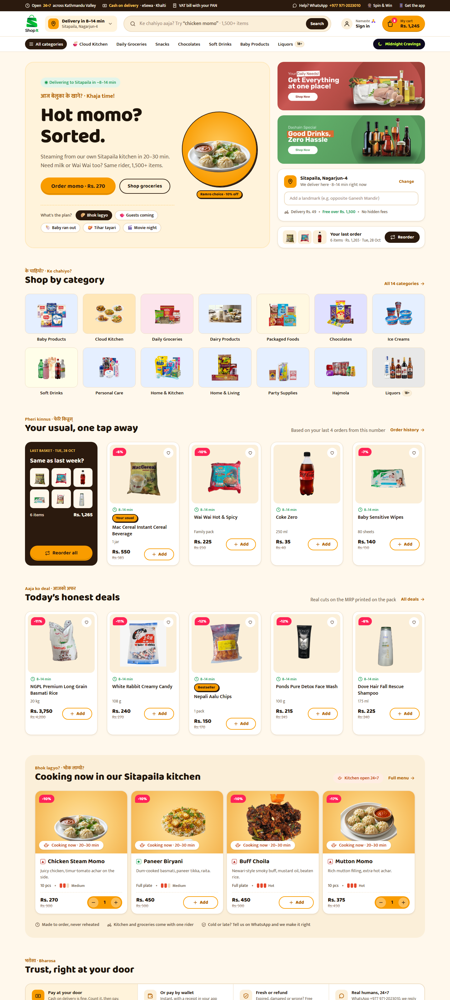

# ShopIt Nepal — Desktop Redesign

A desktop UI redesign of [shopitnepal.com](https://www.shopitnepal.com), a Kathmandu quick-commerce store that delivers groceries in about 8–14 minutes and runs its own cloud kitchen (momo, choila, biryani). This is a **redesign concept, not a copy**. It keeps the real catalogue, prices and brand, then reworks the layout, hierarchy and voice for desktop shoppers.

**Figma file:** [Shopit](https://www.figma.com/design/slryFuBD4zaAtoZKUWJpRK/Shopit?node-id=0-1)



## Screens

| # | Screen | Preview |
|---|---|---|
| 00 | Design system: tokens, type, components | [PNG](screens/00-design-system.png) · [HTML](desktop/00-design-system.html) |
| 01 | Home | [PNG](screens/01-home.png) · [HTML](desktop/01-home.html) |
| 02 | About | [PNG](screens/02-about.png) · [HTML](desktop/02-about.html) |
| 03 | Product listing | [PNG](screens/03-products.png) · [HTML](desktop/03-products.html) |
| 04 | Product detail | [PNG](screens/04-product-detail.png) · [HTML](desktop/04-product-detail.html) |
| 05 | Cart | [PNG](screens/05-cart.png) · [HTML](desktop/05-cart.html) |
| 06 | Payment | [PNG](screens/06-payment.png) · [HTML](desktop/06-payment.html) |
| 07 | Order confirmed | [PNG](screens/07-order-confirmed.png) · [HTML](desktop/07-order-confirmed.html) |
| 08 | Home, Midnight Cravings mode | [PNG](screens/08-home-midnight.png) · [HTML](desktop/08-home-midnight.html) |

`shopit-desktop-all.html` holds every screen on a single page.

## Design decisions
- **Grid:** 1440px frame, 1280px container, 12 columns with 24px gutters, 4px-based spacing scale.
- **Colour:** amber primary (used as a fill, with cocoa text for contrast), cocoa secondary, and pink reserved for deals. The green appears only in the logo.
- **Type:** Baloo 2 for headings and Mukta for body text. Both render Devanagari.
- **Voice:** functional labels stay in English, with friendly Nepali touches in kickers and empty states ("Ke chahiyo aaja?", "Bhok lagyo?").
- **Trust:** cash on delivery comes first and is pre-selected, followed by eSewa and Khalti. Delivery times are always shown as honest ranges ("8–14 min"), and a VAT bill and WhatsApp support appear at every money moment.

The full rules are in [`desktop/_spec.md`](desktop/_spec.md).

## Structure
```
desktop/   HTML screens (_shell.html = shared header/footer, _spec.md = design rules)
assets/    logos, banners, category and product images (sources in assets/manifest.md)
screens/   PNG renders of each screen at 1440px
```

## Credits
Product photos, logos and banners belong to ShopIt Nepal and are used here for a non-commercial portfolio redesign.
